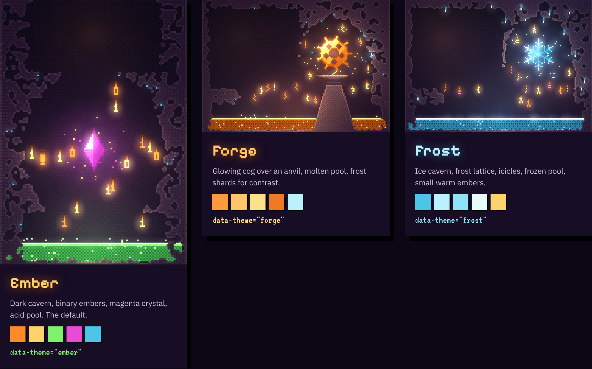
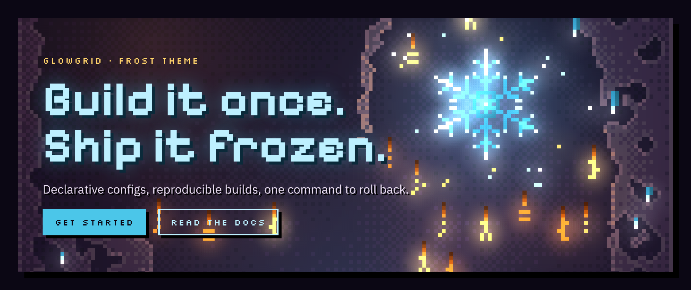
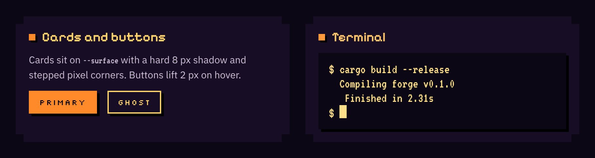
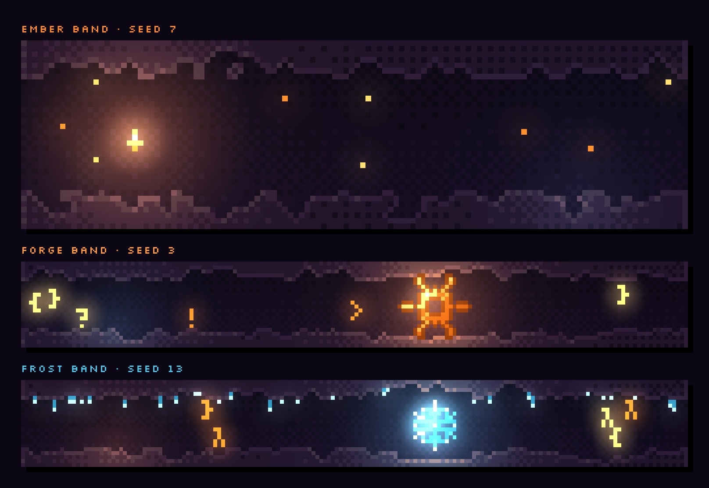
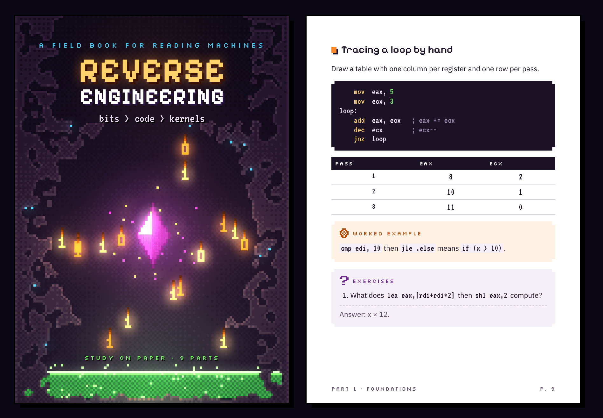
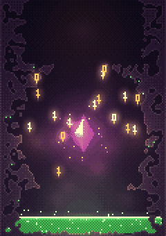
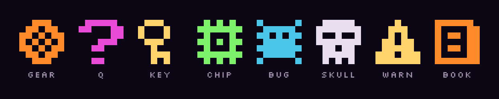

# Glowgrid

**Pixel art lit from within.** Glowgrid is a small design system for books, PDFs, covers, landing pages, slides and animated scenes. Every scene is a dark world where the only light comes from glowing objects inside it. The art is generated by code on a tiny grid, scaled up with hard edges, then given a soft bloom. The type, tokens and components around it share the same rules: hard pixels, hard shadows, soft light.

It comes with three themes, and you can add your own:

| Theme | Scene | Lights |
| --- | --- | --- |
| **Ember** (default) | Dark cavern, binary embers, a crystal, an acid pool | orange, gold, green, magenta, cyan |
| **Forge** | A glowing cog over an anvil, a molten pool, frost shards | orange, amber, pale gold, ice |
| **Frost** | Ice cavern, a six-armed frost lattice, icicles, a frozen pool | cyan, ice white, warm ember |
| **Geode** | Crystal cavern, one isometric crystal cube with a lit grid, crystal spikes, a violet light pool | violet, lavender, warm amber |



Open [`docs/themes.html`](docs/themes.html) in a browser to see them live, and [`docs/examples.html`](docs/examples.html) for every example below.

## What's in here

| Path | What it is |
| --- | --- |
| [`RULES.md`](RULES.md) | **The design rules.** Principles, tokens, type, layout, components, art pipeline, glow strengths, motion, how to make a theme, how to make a PDF. |
| [`tokens.json`](tokens.json) | Every token and theme as JSON, for other tools or build steps. |
| [`core/glowgrid.js`](core/glowgrid.js) | The art engine. Seeded terrain, lighting, dither, bloom, 12 fps animation, icons and the theme registry. No dependencies. |
| [`core/glowgrid.css`](core/glowgrid.css) | Semantic CSS tokens and components: pixel corners, hard shadows, code blocks, panels, tables, covers and bands. |
| [`themes/`](themes/) | `ember.css`, `forge.css` + `forge.js`, `frost.css` + `frost.js`, `geode.css` + `geode.js`. CSS recolors; JS adds the scene painters. |
| [`docs/`](docs/) | `themes.html` (overview), `ember-theme.html` (full live reference with animation), `forge-book-preview.html` and `frost-book-preview.html` (complete book layouts). |
| [`fonts/`](fonts/) | Pixelify Sans, Silkscreen, VT323 and IBM Plex Sans as .ttf files, with their OFL licenses. |
| [`skills/glowgrid/SKILL.md`](skills/glowgrid/SKILL.md) | The rules packaged as a Claude skill. Copy the folder into a project's `.claude/skills/`. |
| [`examples/nixos-field-book/`](examples/nixos-field-book/) | A working book pipeline: Markdown in, landscape two-column A4 PDF out. |

## Quick start

```html
<link rel="stylesheet" href="https://fonts.googleapis.com/css2?family=Pixelify+Sans:wght@400;600;700&family=Silkscreen&family=VT323&family=IBM+Plex+Sans:ital,wght@0,400;0,600;1,400&display=swap">
<link rel="stylesheet" href="core/glowgrid.css">
<link rel="stylesheet" href="themes/frost.css">   <!-- optional: recolors the page -->

<canvas data-glow="cover" data-theme="frost" data-seed="2605"></canvas>
<canvas data-glow="band"  data-theme="ember" data-seed="7" data-accent="#4bc6e9"></canvas>
<canvas data-glow="animate" data-seed="1337"></canvas>
<canvas data-glow="icon" data-icon="gear" data-color="#b24d0a" width="7" height="7"></canvas>

<script src="core/glowgrid.js"></script>
<script src="themes/frost.js"></script>          <!-- load the themes you use -->
<script>Glowgrid.autoInit();</script>
```

From JavaScript: `Glowgrid.draw(canvas, { theme: "forge", kind: "cover", seed: 1515 })`. `kind` is `cover`, `band`, `animate` (ember only for now; returns `{ stop() }`) or `icon`.

## Examples

Every example below assumes the fonts, `core/glowgrid.css` and `core/glowgrid.js` from the quick start are loaded, plus the theme files it uses, and ends with `Glowgrid.autoInit()`. The images were captured from [`docs/examples.html`](docs/examples.html).

### Landing page hero

A full-bleed scene behind a title, a short line and two buttons. The scene fills the box with `object-fit: cover`, so any aspect ratio works.



```html
<link rel="stylesheet" href="themes/frost.css">
<script src="themes/frost.js"></script>

<section class="hero">
  <canvas data-glow="cover" data-theme="frost" data-seed="2605"></canvas>
  <div class="in">
    <div class="label">Glowgrid · Frost theme</div>
    <h1>Build it once.<br>Ship it frozen.</h1>
    <p>Declarative configs, reproducible builds, one command to roll back.</p>
    <div class="btns">
      <button class="btn">Get started</button>
      <button class="btn ghost">Read the docs</button>
    </div>
  </div>
</section>
```

### Cards, buttons and a terminal

Cards use `--surface` with a hard 8 px shadow. Add `.px` for stepped pixel corners instead (the clip removes the shadow). Put `data-theme` on any element to relight just that part of the page.



```html
<div class="card px">
  <h3>Cards and buttons</h3>
  <p>Cards sit on --surface with a hard 8 px shadow and stepped pixel corners.</p>
  <button class="btn">Primary</button>
  <button class="btn ghost">Ghost</button>
</div>

<div class="card px" data-theme="forge">
  <h3>Terminal</h3>
  <div class="term">$ cargo build --release<br>  Finished in 2.31s<br>$ <span class="cur"></span></div>
</div>
```

### Section bands

Bands are wide, short scenes for page headers and part openers. The seed picks the layout, and the same seed always draws the same picture.



```html
<canvas data-glow="band" data-theme="ember" data-seed="7"></canvas>
<canvas data-glow="band" data-theme="forge" data-seed="3"></canvas>
<canvas data-glow="band" data-theme="frost" data-seed="13"></canvas>
```

### Print pages: cover and content

A4 pages for books and PDFs. The cover is full-bleed art; the content page is white with ink, code on dark, a trace table, and worked-example and exercise panels.



```html
<div class="page cover">
  <canvas data-glow="cover" data-seed="1337"></canvas>
  <div class="ttl">
    <div class="kicker">A field book for reading machines</div>
    <h2>REVERSE<span>ENGINEERING</span></h2>
    <div class="sub">bits &gt; code &gt; kernels</div>
  </div>
  <div class="foot">Study on paper · 9 parts</div>
</div>

<div class="page paper">
  <div class="pg-in">
    <h3 class="sec">Tracing a loop by hand</h3>
    <pre class="code px"><span class="k">mov</span>  eax, <span class="n">5</span>   <span class="c">; comment</span></pre>
    <table class="t"><tr><th>Pass</th><th>eax</th></tr><tr><td>1</td><td>8</td></tr></table>
    <div class="box worked px">
      <div class="tag"><canvas data-glow="icon" data-icon="gear" data-color="#b24d0a" width="7" height="7"></canvas>Worked example</div>
      <p>...</p>
    </div>
    <div class="box exer px">
      <div class="tag"><canvas data-glow="icon" data-icon="q" data-color="#6b2b8f" width="7" height="7"></canvas>Exercises</div>
      <ol><li>...</li></ol>
      <p class="ans">Answer: ...</p>
    </div>
  </div>
  <div class="folio"><span>Part 1 · Foundations</span><span>p. 9</span></div>
</div>
```

### Animated scene

`animate` runs at 12 fps with held frames: embers rise and flicker, the crystal pulses, the pool shimmers. It shows the still frame when the user prefers reduced motion.



```html
<canvas id="live"></canvas>
<script>
  const anim = Glowgrid.draw(document.getElementById("live"), { kind: "animate", seed: 1337, scale: 4 });
  // later: anim.stop();
</script>
```

### Icons

Eight 7x7 one-bit icons, drawn in any color: `gear`, `q`, `key`, `chip`, `bug`, `skull`, `warn`, `book`.



```html
<canvas data-glow="icon" data-icon="chip" data-color="#7cf36b" width="7" height="7"
        style="width:56px;height:56px;image-rendering:pixelated"></canvas>
```

### Drawing from JavaScript

```js
// pick a theme and a scene kind, draw into any canvas
Glowgrid.draw(canvas, { theme: "forge", kind: "cover", seed: 1515 });

// add your own theme (see RULES.md section 7)
Glowgrid.register("deepsea", {
  cover(canvas, o) { /* build terrain with Glowgrid.cave, light it, bloom it */ },
  band(canvas, o)  { /* ... */ }
});
```

### Themes in CSS

`core/glowgrid.css` defines semantic tokens (`--bg`, `--surface`, `--accent`, `--accent-hot`, `--glow-1..3`, `--ink`, ...) with Ember values. Loading a theme file recolors the whole page. To mix themes on one page, put `data-theme="forge"` on any element and copy that theme's token block into a `[data-theme="forge"]` rule, as [`docs/themes.html`](docs/themes.html) does.

### Your own theme

Copy `themes/frost.css` and `themes/frost.js`, change the lights and the focal object, register the new emissive colors, then call `Glowgrid.register("mytheme", { cover, band })`. [RULES.md section 7](RULES.md#7-making-a-new-theme) walks through it.

### Making a PDF

```sh
cd examples/nixos-field-book
pip install pypdf beautifulsoup4     # also needs pandoc, node and playwright
python3 build/make.py /tmp/work out.pdf
```

It concatenates `src/*.md`, runs pandoc, turns fenced divs (`.worked .exer .tip .pit .term .case`) into styled panels, renders each part to its own PDF and merges them, then runs a second pass for page numbers.

## The rules in one screen

1. Light lives inside the world. Every bright pixel is a light source.
2. Hard pixels, soft light. Never blur or smooth-scale the art.
3. Small grid, big scale: about 120 art pixels wide, upscaled 4x on screen and 8x in print.
4. Ramps and Bayer dither, no gradients.
5. One focal light per scene.
6. Every scene comes from a seed. Record it.
7. Color on dark covers, ink on white paper inside.
8. Original art only.

Type: **Pixelify Sans** for titles, **Silkscreen** for labels, **VT323** for code, **IBM Plex Sans** for body text. Motion runs at 12 fps in whole-pixel steps. No rounded corners, no soft shadows.

## Compatibility

Glowgrid started as the "Ember Cave" style. The engine still exposes `window.Ember` and accepts `data-ember="..."`, and the CSS keeps the old variable names (`--ember`, `--void`, `--acid`, ...) as aliases, so older pages keep working.

## Licenses

The fonts are from Google Fonts under the SIL Open Font License 1.1 (`OFL.txt` in each folder): free to use, embed and bundle, not to sell on their own. Everything else is original work in this repository.
